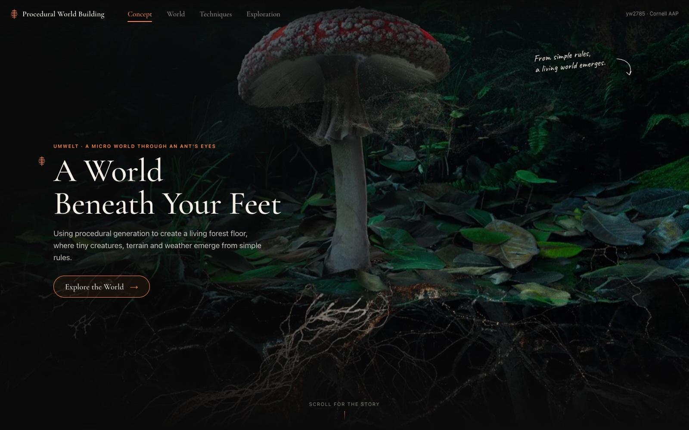
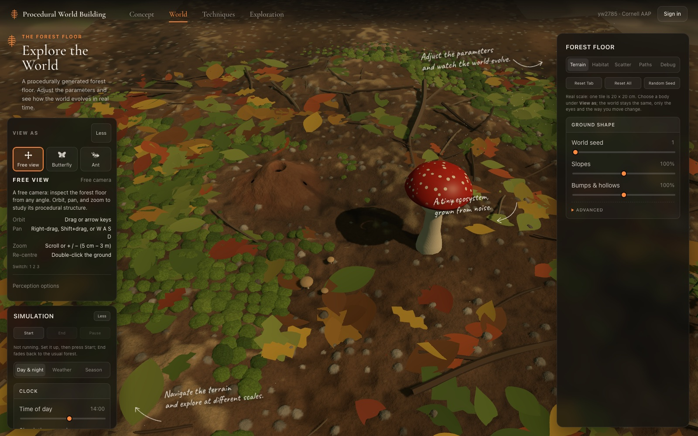
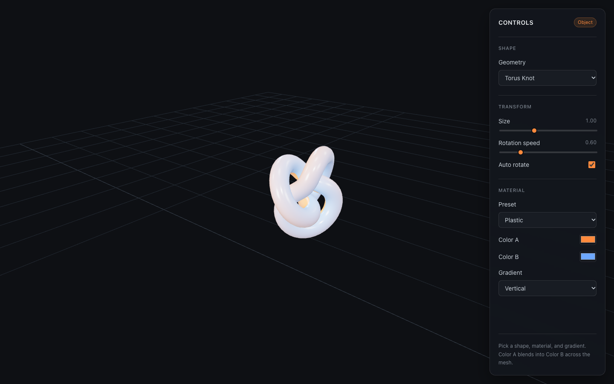
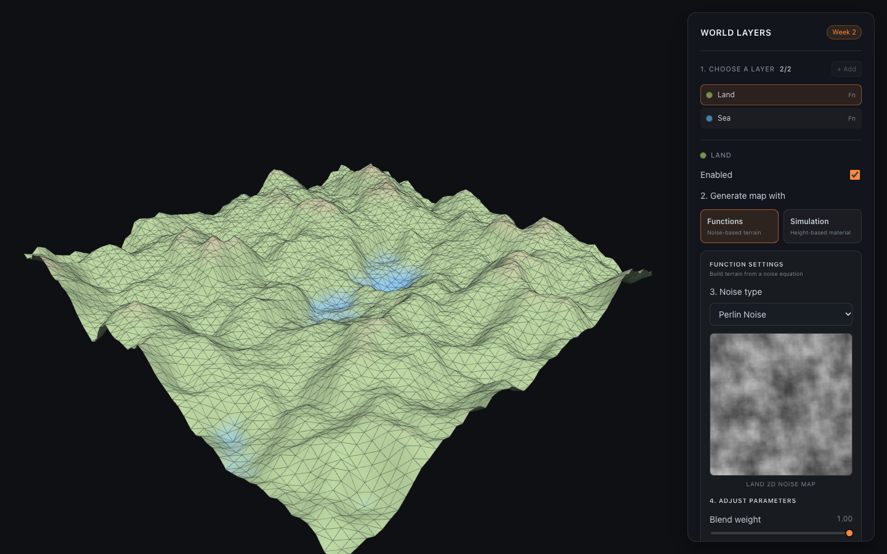
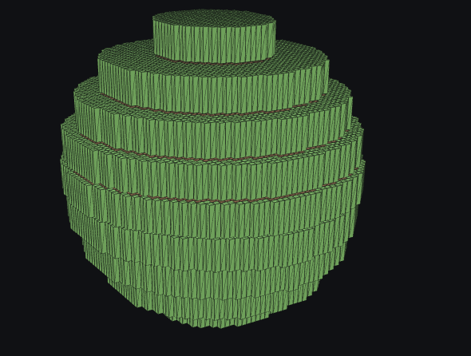
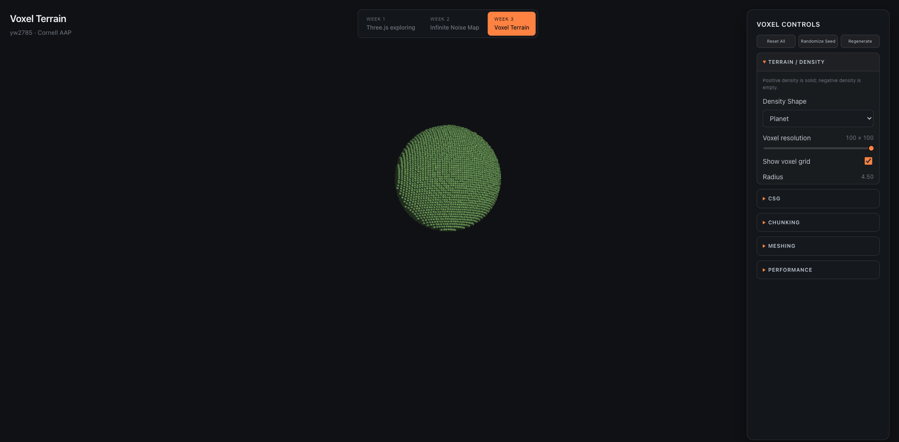
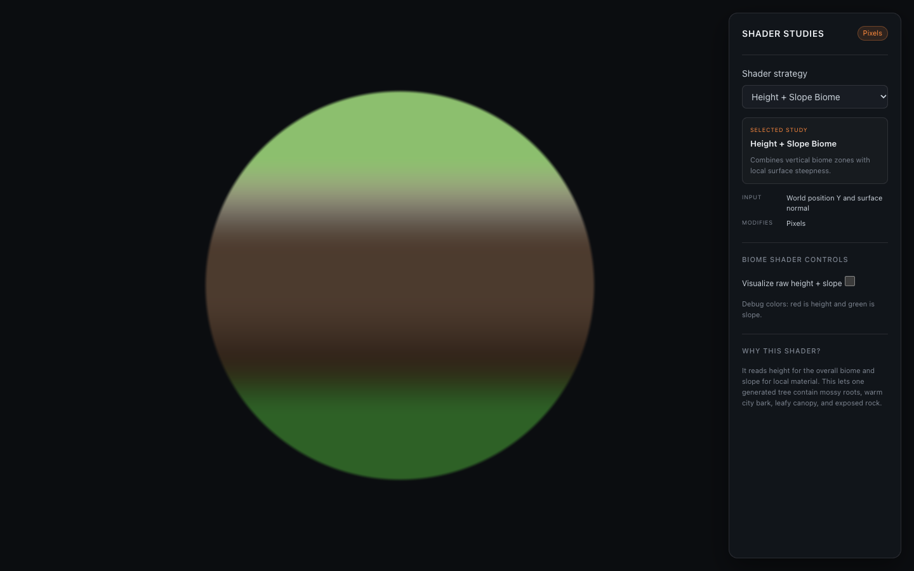
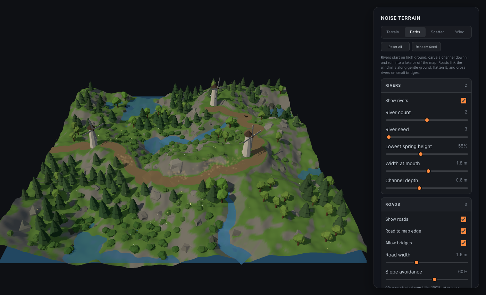

# Procedural World Building

Coursework for **Procedural World Building** at Cornell AAP, Fall 2026, built
with React, Vite, and Three.js. The site has two halves. **Exploration** holds
the weekly studies — one per class, each taking a single technique apart with
its parameters on screen. **Project** puts them back together: **Umwelt**, an
endless forest floor seen through an ant's eyes.

Each week is a study in the Exploration page and a chapter in the study
notebook under [`docs/`](docs/). The site accumulates as the course goes rather
than replacing what came before, so every earlier study is still reachable and
still runs.



## Contents

- [The project](#the-project) — Umwelt
- [Weekly studies](#weekly-studies) — the Exploration page
  - [Week 1 — Three.js Exploring](#week-1--threejs-exploring)
  - [Week 2 — Infinite Noise Map](#week-2--infinite-noise-map)
  - [Week 3 — Voxel Terrain](#week-3--voxel-terrain)
  - [Week 4 — Shader Studies](#week-4--shader-studies)
  - [Week 5 — Distributions](#week-5--distributions)
  - [Week 6 — Trees](#week-6--trees)
- [Study notebook](#study-notebook) — the full documentation index
- [Keyboard](#keyboard)
- [Getting started](#getting-started)
- [Project structure](#project-structure)
- [Conventions](#conventions)
- [Built with](#built-with)

## The project

**Umwelt: A Micro World Through an Ant's Eyes** — *one forest floor, seen
through different senses.* At human scale the ground is soil, pebbles, moss
and fallen leaves. At ant scale, about **1 : 340**, a pebble becomes a boulder,
moss becomes a forest, and a fly agaric mushroom becomes a 40 m tower. The
title comes from Jakob von Uexküll's *umwelt*: every animal lives in its own
perceived world, shaped by its senses.

    build the ground → cover it → make it endless → change who is looking

The project has three goals: **build the world** (a height field with ground
cover and a landmark), **make it endless** (seeded tiles streamed around the
viewer, so coming back shows the same ground), and **change how it is
perceived** (the world stays the same; only cameras and shaders change).

Three pages, none of them a week — the project cuts across all of them:

- **Concept** — the idea, the references (Marshmallow Laser Feast's *In the
  Eyes of the Animal* and *Poetics of Soil: Fly Agaric I*), the system
  architecture, and the feature scope: what is built, what is next.
- **World** — the working micro world, and the page to try first:
  - **Terrain** — an endless, seeded forest floor in real metres, streamed in
    20 cm tiles in near and middle rings, with a far ground beyond them so
    the world has no edge. Pebbles, hollows and an ant hill are stamped into
    the height field.
  - **Habitat** — slope, hollows, shade, sunlight, wind and moisture, each a
    pure function of position and seed, decide what grows where.
  - **Ground cover** — tree trunks, fallen leaves and leaf drifts, twigs,
    moss patches, flower colonies, mushrooms, and the **fly agaric** landmark
    (lathe-shaped stem and cap, cellular-noise spots).
  - **Paths** — a worn ant trail from the ant hill to the fly agaric along a
    Catmull-Rom spline, with pheromone controls and exclusion zones.
  - **View as** — **Free view** (orbit, pan, zoom), **Butterfly** (flies at
    about 60 cm, sees ultraviolet, chase or eye camera), and **Ant** (4 mm eye
    height, compound-eye vision, follows scent trails and enters tunnels).
  - **Simulation** — a day/night cycle with sun and moon, weather presets
    from Clear to Autumn storm (rain, fog, lightning, wet ground that dries),
    and seasons from Spring to Late autumn. None of it regenerates the world.
- **Techniques** — the procedural techniques the world is built from, and the
  week each one was first studied in.



Full concept, scale table, perception modes and milestones:
[`docs/planning/project-design.md`](docs/planning/project-design.md).
Prioritised features: [`docs/planning/backlog.md`](docs/planning/backlog.md).

## Weekly studies

The Exploration page. Each week is one technique, taken apart.

### [Week 1 — Three.js Exploring](docs/class-notes/week-1-threejs-exploring.md)

An interactive viewer for one object. Eight primitives from box to torus knot,
seven material presets and a two-colour gradient, orbit controls with damping,
and a key, rim and ambient light. A generated `RoomEnvironment` gives metal
something to reflect, and the normal and roughness maps are drawn in code, with
no image files.



### [Week 2 — Infinite Noise Map](docs/class-notes/week-2-infinite-noise-map.md)

A terrain made only from noise. Two **earth layers**, Land (Perlin) and Sea
(cellular), are blended into a height map coloured from sea to snow. The map is
infinite: W A S D samples a new part of the same noise, so the world goes on
forever and looks the same when you return.

- **Noise types** — white, Perlin and cellular, each with scale, octaves,
  persistence, lacunarity and seed.
- **Functions or simulation** — a layer adds height, or becomes an animated
  overlay instead.
- **Previews** — the selected layer's noise and the combined blend, side by
  side.



### [Week 3 — Voxel Terrain](docs/class-notes/week-3-voxel-terrain.md)

Solid ground as a 3D density field: positive is solid, negative is empty.

- **Density shapes** — ground plane, 3D fBm, ridged, terraced, floating
  islands, planet and strata.
- **Sequential CSG** — union, subtraction and intersection of spheres, boxes
  and capsules, applied to the density field itself, so voxels and mesh see the
  same edit. Presets for a cave room, tunnel, arch and rock addition.
- **Chunking and optimization** — one instanced mesh per chunk, empty chunks
  skipped, distance-based activation, coarser distant chunks, with before/after
  instance counts.
- **Marching Cubes** — a smooth surface at an adjustable isovalue, shown as
  voxels, mesh, or both; Surface Nets and Dual Contouring documented for
  comparison.

| Before the fix: tall voxels | After: cubic voxels |
| --- | --- |
|  |  |

### [Week 4 — Shader Studies](docs/class-notes/week-4-shape-exploring.md)

Eight small GPU programs written directly in **WebGL and GLSL**, not three.js
materials, so it is clear what runs on the GPU. Each study says what it reads,
what it changes, and why it is useful:

| Study | Reads | Changes |
| --- | --- | --- |
| Default | nothing | nothing (neutral comparison) |
| Height Gradient | world height | pixel colour |
| Slope | surface normal | pixel colour |
| Height + Slope Biome | height and normal | pixel colour |
| Vertex Displacement | position and time | vertex positions |
| Fresnel Glow | normal and camera direction | pixel colour |
| Distance Fog | distance from the camera | pixel colour |
| Procedural Noise | position and time | pixel colour |



### [Week 5 — Distributions](docs/class-notes/week-5.md)

A small procedural world built in layers, each reading the layers before it,
and each step cached so a tree slider never re-routes the roads.

- **Noise terrain** — fractal Perlin heights, grass on flat ground and rock on
  steep ground, plus shared data maps: slope, sun, moisture, and distance to
  cliffs, water and roads.
- **Placement protocols** — windmills, rocks, pines, round trees and bushes,
  each filtered by surface, slope, height, cliff, water, road and spacing
  rules; Poisson disk spacing with noise-masked groves.
- **Terrain-driven variation** — size, shape, colour and density follow the
  ground each instance stands on.
- **Rivers and roads** — rivers traced downhill after pit filling; roads routed
  with A\* between windmills chosen by a minimum spanning tree, smoothed with
  Catmull-Rom splines, with bridges.
- **Wind** — one wind field shaped by the terrain, with gusts and curl-noise
  turbulence, blowing leaves, seeds and dust, swaying trees and turning
  windmills.



### [Week 6 — Trees](docs/class-notes/week-6-Trees.md)

*Not written yet.*

## Study notebook

The write-ups are the coursework, not a side effect of it. The full index is
in **[`docs/README.md`](docs/README.md)**. In short:

| Area | Contains |
| --- | --- |
| [`docs/class-notes/`](docs/class-notes/) | One chapter per week, plus the chronological [weekly notes](docs/class-notes/weekly-notes.md) |
| [`docs/planning/`](docs/planning/) | The [project design](docs/planning/project-design.md) and the prioritised [feature backlog](docs/planning/backlog.md) |
| [`docs/tutorials/`](docs/tutorials/) | [React setup](docs/tutorials/react-setup.md) for beginners, and [Firebase setup](docs/tutorials/Firebase%20setup.md) for the prototype |
| [`docs/analysis/`](docs/analysis/) | Case studies, comparisons and post-mortems (none written yet) |
| [`docs/assets/`](docs/assets/) | Screenshots used by the notes |

## Keyboard

On the World page:

| Key | Effect |
| --- | --- |
| `1` / `2` / `3` | View as Free view, Butterfly, or Ant |
| `W` `A` `S` `D` | Free view: pan · Butterfly: fly and turn · Ant: walk |
| `Shift` | Move faster |
| Arrow keys | Look around (Free view: orbit) |
| `+` / `−` | Zoom, or move the chase camera closer or further |
| `Space` / `C` | Butterfly: rise / sink |
| `V` | Butterfly: switch between chase camera and eye view |
| `Space` | Ant: follow the scent trail |
| `E` | Ant: enter a tunnel, when near one |

In Free view, drag to orbit, right-drag or Shift-drag to pan, scroll to zoom,
and double-click the ground to re-centre. Week 2 also uses `W` `A` `S` `D` to
travel across its infinite map.

## Getting started

```bash
cd react-practice
npm install
cp .env.example .env.local
npm run dev
```

Then open the URL Vite prints (default `http://localhost:5173`).

| Script | Purpose |
| --- | --- |
| `npm run dev` | Start the dev server with hot module replacement |
| `npm run build` | Produce a production build in `dist/` |
| `npm run lint` | Run ESLint |
| `npm run preview` | Serve the production build locally |
| `npm run deploy` | Build and deploy to Firebase Hosting |

Fill `.env.local` with the Firebase web-app configuration from the
[Firebase setup tutorial](docs/tutorials/Firebase%20setup.md). No world data is
saved yet; the plan is to save parameters only, never geometry, because the
generator is deterministic. Never commit `.env.local`.

## Project structure

```
react-practice/src/
├── main.jsx                  Entry point
├── App.jsx                   Page switching: Concept, World, Techniques, Exploration
├── siteContent.js            The pages, the weekly studies, and the URL hash
├── components/               Site pages and the weekly studies
│   ├── ConceptPage.jsx       Concept — idea, references, architecture, features
│   ├── WorldPage.jsx         World — the Umwelt map
│   ├── TechniquesPage.jsx    Techniques — what the world is built from
│   ├── ExplorationPage.jsx   Exploration — the weekly timeline
│   ├── Week1Scene.jsx        Week 1 — object viewer
│   ├── Week2Scene.jsx        Week 2 — infinite noise map
│   ├── Week3Scene.jsx        Week 3 — voxels, CSG, chunking, Marching Cubes
│   ├── Week4Scene.jsx        Week 4 — shader studies
│   └── Week5Scene.jsx        Week 5 — terrain, scatter, paths, wind
├── project/                  The World — separate from the weekly studies
│   ├── MapScene.jsx          The scene, render loop and streaming
│   ├── MapPanel.jsx          Terrain / Habitat / Scatter / Paths / Debug tabs
│   ├── terrain/              Height field, tiles, ground material, far ground
│   ├── habitat/              Slope, shade, sunlight, wind and moisture fields
│   ├── cover/                Trunks, leaves, moss, flowers, mushrooms, fly agaric
│   ├── paths/                Ant trail, tunnels, exclusion zones
│   ├── forest/               Sky
│   ├── viewpoints/           Free view, butterfly, ant: movement, cameras, vision
│   ├── simulation/           Day/night, weather, rain, fog, seasons, ambient life
│   └── panel/                Shared panel controls and layout
├── shaders/                  Week 4's GLSL studies and WebGL helpers
├── utils/                    Noise, density, scattering, splines, rivers, roads, wind
├── services/                 Auth and world storage
└── lib/firebase.js           Firebase and Firestore initialization
```

## Conventions

**The world is a function of position and seed.** Terrain, habitat fields and
stamps are pure functions of world position, so any tile can be built on its
own, neighbouring tiles agree at their edges, and walking back shows exactly
the same ground. Nothing is kept in a global list.

**Real units, honest scale.** The World is modelled in metres. Switching from
human to ant is a camera change — eye height, field of view, speed — not a
different world.

**Perception changes the view, not the geometry.** Each viewpoint is a camera,
a movement model and a preset of numbers for one full-screen vision shader, so
switching only changes uniforms. Seasons and weather move levels on cover that
was scattered once; they never regenerate it.

**Logic is plain data.** Modules marked *Plain data only, no Three.js* hold the
rules; rendering lives in separate files, so the rules can be read and tested
without a scene.

**Moving never stutters.** Tiles are built nearest-first within a small time
budget per frame, and old meshes stay visible until their replacement is
ready.

**Every major folder has a README.** Notes link back to their section index
and to the code they describe. Screenshots live in `docs/assets/screenshots/`.
Tutorials state a goal, prerequisites, exact steps, a result, and pitfalls.
Analyses state evidence and a conclusion rather than only summarising.

**Generated data is not committed.** Voxel arrays, caches, build outputs and
local environment files stay out of the repository.

## Built with

React 19 · Vite · Three.js · Firebase

Planned for authoring and presentation: Houdini · Unreal Engine 5 · Blender

---

**yw2785** · Cornell AAP · Fall 2026
